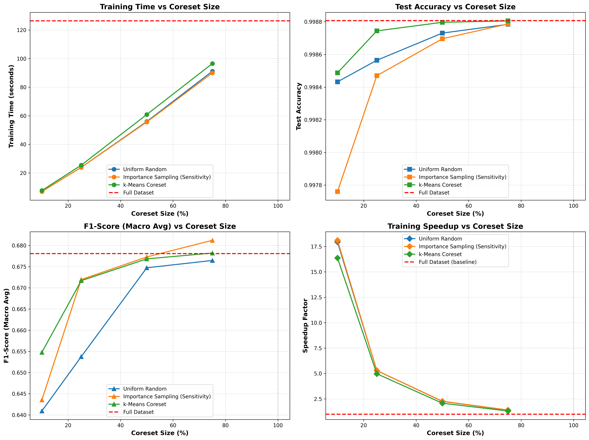
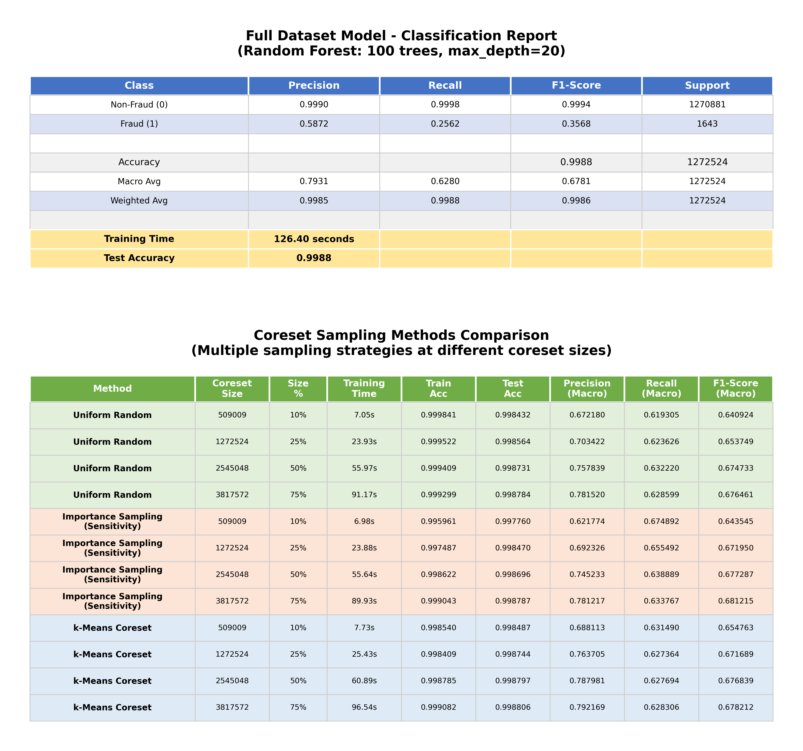

# Financial Fraud Detection: Data Analysis and Scalable Modelling

An end-to-end data analysis project on **6.36 million mobile-money transactions**. It covers data cleaning, exploratory analysis, statistical hypothesis testing and a Random Forest fraud model trained on coreset samples for faster training.

**Tools:** Python · Pandas · NumPy · SciPy · Statsmodels · Scikit-learn · NetworkX · Matplotlib · Seaborn

---

## Problem

Only **0.13%** of transactions (8,213 of 6,362,620) are fraudulent. The project set out to answer three questions:
1. What separates fraudulent transactions from legitimate ones?
2. How well does the bank's existing fraud rule work?
3. Can we train a fraud model on a small sample of the data without losing performance?

## Dataset

`Data/syn_fin_ds.csv` is a synthetic financial transactions dataset (PaySim format) with 11 columns:
transaction step (hour), type, amount, origin and destination account IDs and balances, `isFraud`, and `isFlaggedFraud`. The bank's current rule flags any transfer over 200,000.

> The data files are stored with **Git LFS** (about 490 MB). Run `git lfs pull` after cloning.

## Repository Structure

| File | Contents |
|---|---|
| `notebook.ipynb` | First-pass data cleaning and exploratory data analysis |
| `notebook copy.ipynb` | Detailed hypothesis testing (H1–H15, effect sizes, bonus analyses) |
| `notebook_hypothesis_testing.ipynb` | Log-transformed t-test, chi-square test and distribution plots |
| `end_sem.ipynb` | **Final notebook:** preprocessing, Random Forest and coreset sampling comparison |
| `coreset_comparison.png` | Training time and performance vs. coreset size |
| `model_comparison_tables.png` | Classification report and full comparison table |

---

## 1. Data Cleaning and Feature Engineering

- **Removed leaking columns:** the four balance columns (`oldbalanceOrg`, `newbalanceOrig`, `oldbalanceDest`, `newbalanceDest`) give away the answer, because fraudulent transactions are cancelled. They were dropped before modelling.
- **Account type:** the first letter of each account ID gives its type (`C` = customer, `M` = merchant). Every transaction starts from a customer account.
- **Cyclical time features:** `step` was converted to an hour of the day and encoded with **sine and cosine**, so the model treats 23:00 and 00:00 as neighbours.
- **Encoding and scaling:** one-hot encoding for transaction and account types, and `StandardScaler` for the amount.

## 2. Exploratory Data Analysis: Key Findings

- **Fraud happens in only two transaction types:** TRANSFER (4,097 cases) and CASH_OUT (4,116 cases). CASH_IN, PAYMENT and DEBIT have no fraud at all.
- **The existing rule barely works:** `isFlaggedFraud` caught only **16 of 8,213** frauds (recall 0.2%).
- **Fraud amounts are much larger:** median about **441K** for fraud vs. about **75K** for legitimate transactions (mean 1.47M vs. 178K). Amounts are heavily skewed, so they were analysed on a log scale.

## 3. Statistical Hypothesis Testing

Amounts are skewed, so non-parametric tests and log transforms were used where appropriate. Effect sizes are reported alongside p-values, because with 6M rows almost any difference is statistically significant.

| # | Hypothesis | Test | Result |
|---|---|---|---|
| H1 | Fraud and legitimate amounts differ | Mann-Whitney U (log amount), Welch t-test | Significant. **Cohen's d = 1.09** (large effect); t = 95.8 |
| H2 | Fraud depends on transaction type | Chi-square (χ² ≈ 22,083) | Significant, Cramér's V = 0.06 |
| H3 | `isFlaggedFraud` separates fraud | Two-proportion z-test | Significant, but the rule's recall is only 0.2% |
| H4 / H8 | Fraud happens at different times of day | Circular statistics (sin/cos t-tests, Fisher's method) | Fraud peaks around **12:37** vs. **15:44** for legitimate transactions; Cramér's V (hour) = 0.18 |
| H6 | Fraud changes balances differently | Mann-Whitney U | Significant: fraud tends to **drain the sender's balance** |
| H7 | Sender–receiver balance gap differs | Mann-Whitney U | Significant |
| H10 | Fraud destinations are reused more | Mann-Whitney U on unique senders per account | Significant: accounts receiving fraud get money from **unusually many different senders** |
| H15 | Same-type vs. cross-type account pairs | Chi-square | Significant |

The notebook also explores network centrality (H11), the predictive value of transaction type and amount (H12), the rule's precision and recall (H13), a type × amount interaction (H14) and three bonus analyses: account activity, Pareto concentration and time between transactions.

> **Note:** the balance-based findings (H6, H7, H10) describe how fraud behaves, but those columns were excluded from the model to avoid leakage.

## 4. Modelling: Random Forest with Coreset Sampling

**Baseline:** a Random Forest (100 trees, max depth 20) trained on the full 5.09M-row training set with an 80/20 stratified split.

| Metric (test set) | Value |
|---|---|
| Training time | 126.4 s |
| Fraud precision | 0.59 |
| Fraud recall | 0.26 |
| Macro F1 | 0.68 |

Accuracy (99.88%) is not a useful measure here, because always predicting "legitimate" scores 99.87%. The model is judged on the minority-class metrics and macro F1.

**Coreset sampling:** to cut training time, three randomized sampling methods were compared at sample sizes of 10%, 25%, 50% and 75%:
1. **Uniform random sampling**, as a baseline.
2. **Importance sampling** based on sensitivity scores, with extra weight on fraud cases.
3. **k-Means coreset sampling**, which samples points in proportion to their distance from cluster centres.

| Method | Sample size | Train time | Speedup | Macro F1 |
|---|---|---|---|---|
| Uniform Random | 10% | 7.05 s | 17.9× | 0.641 |
| Importance Sampling | 10% | 6.98 s | **18.1×** | 0.644 |
| k-Means Coreset | 10% | 7.73 s | 16.4× | 0.655 |
| k-Means Coreset | 25% | 25.43 s | 5.0× | 0.672 |
| Importance Sampling | 75% | 89.93 s | 1.4× | **0.681** |
| Full dataset | 100% | 126.40 s | 1.0× | 0.678 |

**Result:** a 10% k-Means coreset trains about **16× faster** and keeps about 97% of the full model's macro F1. A 25% coreset gives up less than 0.01 F1 for a 5× speedup.




## 5. Limitations and Future Work

- Fraud recall (26%) is low. Next steps: class weighting or resampling, threshold tuning, and gradient-boosted models (XGBoost or LightGBM).
- The coreset weights are calculated but not yet passed to the Random Forest (`sample_weight`).
- Evaluate with PR-AUC, and use time-based train/test splits to reflect real deployment.

## How to Run

```bash
git clone https://github.com/c0d3l0v3r-HeHe/D-Sc.-Project.git
cd D-Sc.-Project
git lfs pull
pip install pandas numpy scipy statsmodels scikit-learn networkx matplotlib seaborn jupyter
jupyter notebook end_sem.ipynb
```

## Team

- **c0d3l0v3r-HeHe:** data cleaning and EDA, feature engineering, hypothesis testing (H1–H15), Random Forest modelling, coreset sampling and the final report
- **Parsh Jain** and **Priyanshu:** t-test analysis, distribution plots and notebook documentation
